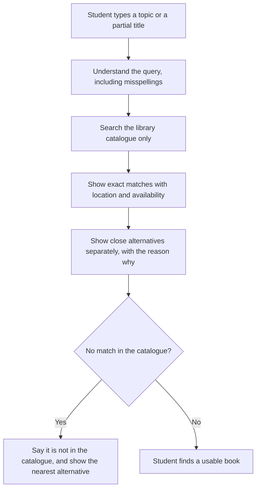

# Smart Library Discovery

## Search That Handles Real Student Queries

**Level:** Practitioner — after Phase 07
**Project type:** Academic AI Product Manager project
**Start with:** a chat tool, documents, and test sets — no software build needed.

## What makes this project unique

This is the only project in the set about **finding, not answering — and about fairness**. A catalogue that only understands exact titles quietly favours students who already know how catalogues work, and leaves everyone else to buy books or cite weaker sources. Its hardest failure is a false "available": sending a student to an empty shelf destroys trust in one trip. Its key test is the 40-search eval, where availability must be 100% correct and at least 85% of searches must surface the right book in the top 3. Diya, the example student in the story below, searches by topic and a half-remembered title and is about to buy a book she cannot afford — the exact gap this discovery product is built to close.

---

## The problem

Library catalogues usually require an exact title and the correct spelling of an author's name.

Students do not search that way. They search by topic, by a partial title they half-remember, or by copying text from a reference list. When that search fails, many students conclude: "the library doesn't have it."

That conclusion is often wrong. The book may be on the shelf. The student simply could not find it.

## Why it matters

When a student cannot find a book, three things happen:

1. **The student loses out.** They may buy a book they cannot afford, or cite a weaker online source instead.
2. **The assignment suffers.** A weaker source can mean a weaker argument and a lower mark.
3. **The library loses evidence.** If searches fail, usage looks low. Low usage makes it harder for the library to justify its budget.

This is a discovery problem and an equity problem. Students who already know how catalogues work get more from the library than students who do not.

## What this project does

Smart Library Discovery helps a student find a usable book for a real assignment, using only the library's own catalogue data.

A student can enter:

- a topic, for example "statistics for psychology assignments";
- a partial or misspelled title;
- or text copied from a reference list.

The system returns:

- **Exact matches** — title, author, edition, shelf location, and live availability;
- **Close alternatives** — clearly separated from exact matches, with a plain-language reason why each one is an alternative.

It never invents availability. It never invents a shelf location. If the data does not say a book is available, the system does not say it is available.

## How it works



`docs/09-diagrams.md` draws that search the way a student actually does it: topic or partial title in, exact matches first, labelled alternatives second, and an honest "not in the catalogue" when that is the truth.

## The story


Diya needs a statistics book for a psychology assignment, cannot find it by topic in the catalogue, and is about to buy a book she cannot afford. With Smart Library Discovery, she finds the exact book in the top results, checks its edition and availability, and goes straight to the shelf. Read the full story in [docs/10-story.md](docs/10-story.md).

## How to use this project

Work through this folder as a product case, not a build. You do not need to build software to learn from it.

1. Start with `docs/01-problem-statement.md` — the problem and the evidence for it.
2. Read `docs/02-research-notes.md` — what to learn from 5 students and 1 librarian, with interview templates.
3. Read `docs/03-spec.md` — what the product does, and what it does not do.
4. Run the test set in `evals/eval-set.csv` — 40 searches, with a rubric in `docs/04-eval.md`.
5. Read `docs/05-metrics.md`, `docs/06-cost-latency.md`, and `docs/07-risks-guardrails.md` before deciding whether the idea is worth building.
6. Finish with `docs/08-release-portfolio.md` — how to release it safely, in stages, and what to show in a portfolio.

## Portfolio proof

This project includes the evidence a hiring manager or tutor can check:

- **Query log analysis** — 25 real student queries, including failures, analysed by type of failure.
- **Eval table** — 40 searches with a rubric and failure reasons grouped, so the same mistake is not counted as five different problems.
- **Librarian sign-off note** — a librarian reviews the 40-search eval before any student sees the product. The sign-off template is in `docs/08-release-portfolio.md`.
- **Routing decision** — a written decision on when to use AI and when plain search is enough, with cost evidence, in `docs/06-cost-latency.md`.

The eval results table is intentionally left blank. Do not fill it in with invented results. Run the searches, record what actually happened, and then write up what you learned.

## Project structure

```text
smart-library-discovery/
├── README.md
├── .gitignore
├── docs/
│   ├── 01-problem-statement.md
│   ├── 02-research-notes.md
│   ├── 03-spec.md
│   ├── 04-eval.md
│   ├── 05-metrics.md
│   ├── 06-cost-latency.md
│   ├── 07-risks-guardrails.md
│   ├── 08-release-portfolio.md
│   ├── 09-diagrams.md
│   └── 10-story.md
├── assets/
│   └── avatar-diya.svg
└── evals/
    └── eval-set.csv
```

## Important limits

- Search covers the provided catalogue data only.
- Availability is shown only when it is in the data, with a timestamp.
- Edition is always displayed, because some assignments require a specific edition.
- If catalogue data is more than 24 hours old, the student is told to "check at desk" instead of being sent to a shelf on stale information.

## Status

This is a study project. All example queries, example catalogue entries, and interview questions in this folder are labelled EXAMPLE or template. They show the shape of the work. Real research, real query logs, and real eval results must be collected before any claim is made about how well the product works.

---

*Created by Siddi, 2026.*
