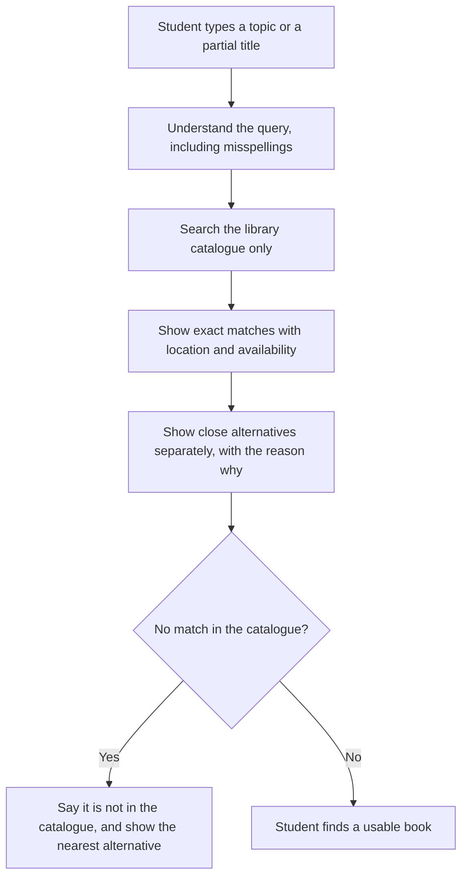
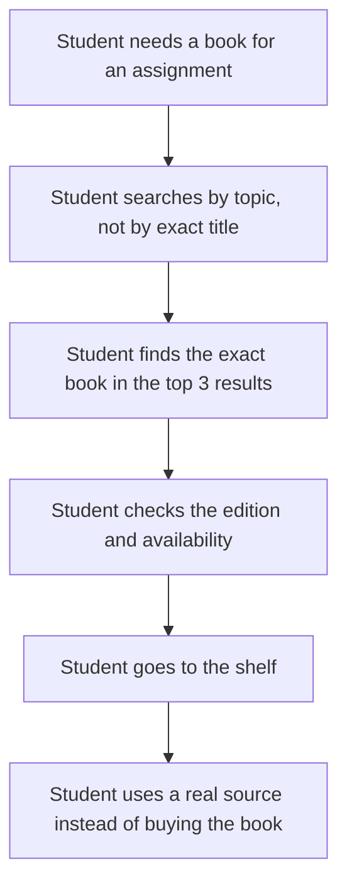
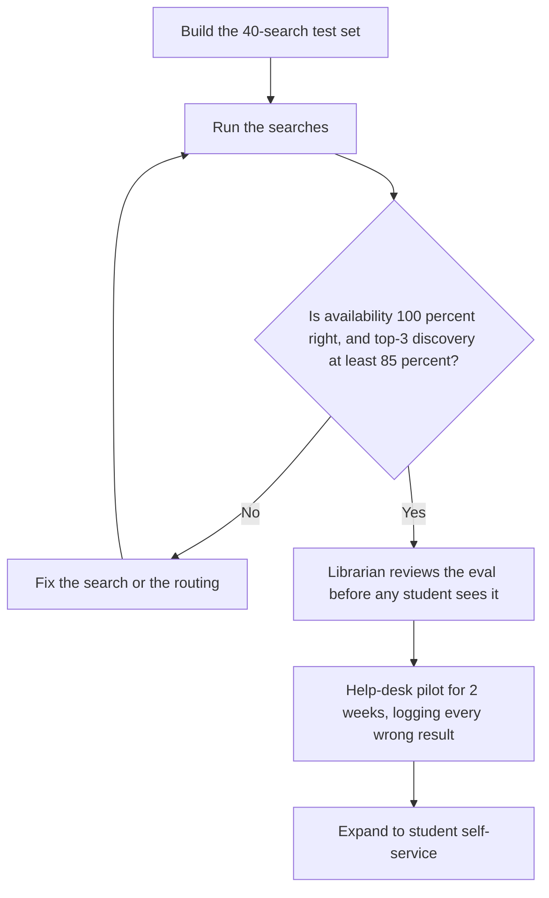

# Diagrams — Smart Library Discovery

These are simple diagrams to help a beginner see how the product works. They match the spec in `docs/03-spec.md`. No image files are used — the diagrams below are written in Mermaid text, which GitHub renders as a picture.

## 1. How it works

What this shows: the system never invents availability or a shelf location. Exact matches and alternatives are kept clearly separate, so the student is not misled.

## 2. User journey

What this shows: before the product, a failed search meant the student thought the library did not have the book. After it, the student finds the book and can trust the availability shown.

## 3. Eval and release flow

What this shows: a librarian checks the product before students do, and the help-desk pilot proves it in real use before it is opened to everyone.
